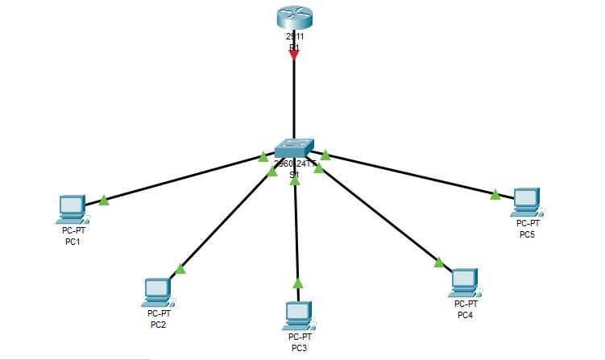

# Small Office Network Design and Configuration

## Objective
Design and configure a small office LAN where all devices can communicate.

## Tools
Cisco Packet Tracer, draw.io

## Topology

## IP Addressing Table
See [ip-addressing-table.md](ip-addressing-table.md)

## Configuration Summary
- 1 router (R1), 1 switch (SW1), 5 PCs
- Network: 192.168.1.0/24
- Gateway: 192.168.1.1 (R1 Gig0/0)
- PCs: 192.168.1.10 to .14 (static)

## Testing and Results

---

---

---

---

---

---

---

---

---

## What I Learned
IP addressing, subnet masks, default gateway, MAC addresses and ARP,
switch vs router roles, straight-through vs crossover cables, ping/ICMP.

## Troubleshooting
## Troubleshooting

**Issue 1: Ping from PC1 to the gateway failed (100% packet loss)**
- Cause: The router interface GigabitEthernet0/0 was not fully configured
  and active. Router interfaces are shut down by default.
- Fix: Assigned the IP address 192.168.1.1/24 and ran `no shutdown`.
- Verification: `show ip interface brief` showed up/up, and pings
  to 192.168.1.1 then succeeded.

**Issue 2: "Invalid input detected" when pinging from the router**
- Cause: I ran `ping` in global configuration mode (`R1(config)#`),
  where it is not available.
- Fix: Returned to privileged mode with `end` (or used `do ping`).

**Note:** The first ping in each test sometimes timed out because
ARP had to resolve the MAC address. Later pings succeeded.

## Files
- topology.pkt: Packet Tracer file
- screenshots/: evidence of each step
